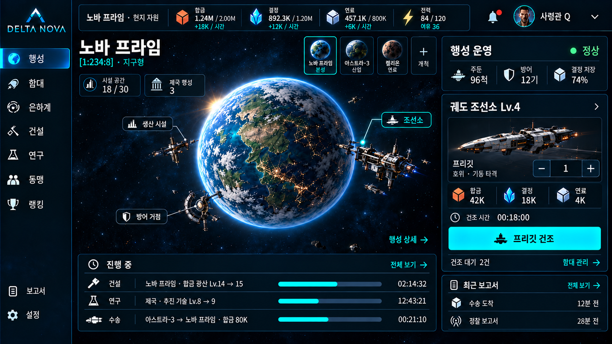

# 델타 노바 제국 운영과 게임 화면 방향 v0.2

2026-10-13. 사용자 요구를 반영한 제품 방향과 다음 개발 범위다. 아래 신규 시스템은 설계 제안이며 현재 실행되는 기능이 아니다. 상세 수치와 파일별 구현 계획은 첫 전체 순환을 대상으로 이어 작성한다.

자원으로 기지와 함대를 성장시키고, 불완전한 정보와 이동 거리를 판단해 공격하며, 자신의 거점을 방어하는 우주 제국 전략을 중심으로 한다. 사용자가 말한 문명 게임의 감각은 거점 확대·입지·기술 선택·영향권에서 얻는다. 닌텐도 게임의 완성도 기준은 형태와 한글의 가독성, 조작 반응, 일관된 게임 화면에 적용한다.

## 현재 구현과 필요한 변화

| 기능 | 현재 실행되는 범위 | 다음 목표 |
|---|---|---|
| 자원 | 합금·보급 생산, 상한, 시설 레벨1..3 | 조선·방어·연구가 경쟁하는 자원 투자 |
| 함대 확보 | 8함종/9척 고정 지급 | 비용과 건조 시간을 지불해 실제 보유량 증가 |
| 출격 | 정해진 임무의 교전과 귀환/추가 진입 | 성계 대상까지 이동·접전·귀환하는 함대 |
| 거리 | 화면 배치용 임무 x/y와 직행/우회 선택 | 항로 거리·속도·연료·도착 시각의 서버 판정 |
| 행성·식민지 | 참가자별 기지 하나, 행성 소유/개척 없음 | 입지 선택·행성별 성장·제국 공통 기술·수송 |
| 정보 | 정찰 지원과 우회 전투 효과 | 정찰함·정보 기술·상대 탐지의 정찰 보고서 |
| 방어 | 임무의 적 포대, 자신의 함선 정비 | 내 주둔 함대·방어시설·센서·보호 자원의 방어 |
| 연구 | HP/화물 모듈 두 종류 | 추진·정보·무장·방어·산업의 해금과 분기 |
| 협동 | 네 역할을 혼자 순차 수행하거나 분담 | 같은 지도에서 정보 공유·수송·증원·협공 |
| 화면 | 임무/편성 패널과 기지 운영 페이지 | 기지·성계를 중심으로 상태와 행동을 연결 |

자원과 몇 개 버튼이 있는 것만으로 제국 운영 순환이 구현됐다고 보고하지 않는다. 정찰 지원은 스파이 시스템이 아니며 임무의 적 포대는 사용자 기지 방어가 아니다.

## 선택한 개발 경로

현재 임무 모델에 건조 버튼만 추가하면 이동·정보전·방어가 계속 분리된다. 공개 PvP와 대규모 은하부터 만들면 기본 경제와 읽기 쉬운 화면의 검증이 늦어진다. 추천 경로는 지속되는 개인 기지와 작은 성계를 먼저 연결하고, 혼자 첫 전체 순환을 완료한 뒤 같은 규칙으로 세계와 협동을 확장하는 것이다.

기존의 생산·서버 명령·중복 방지·저장 이전·전투 이벤트는 검토해 재사용한다. 현재의 고정 함선 지급, 6척 편성, 임무 사이 추가 진입, 네 역할 보드는 전체 제국 게임의 영구 제약으로 채택하지 않는다. 브라우저 연습은 보존하고 새 기본 화면은 제국 기지로 전환하는 방향이다.

## 경제와 건설

첫 자원 제안은 합금·결정·연료다. 합금은 구조물과 선체, 결정은 센서·방어막·정밀 기술, 연료는 함대 이동의 병목을 만든다. 전력은 비축 소비재가 아니라 시설을 가동하는 지원량으로 보여준다. 구체적인 비용과 생산률은 투자 회수·공격 순수익·복구 소요를 함께 검증해 정한다.

자원 시설·발전·저장·조선소·연구소·센서·방어 설비에 자원을 투자한다. 건설·연구·함선 건조는 별도 작업으로 표시하고 시작 비용, 완료 시각, 취소 결과를 사전에 보여준다. 완료된 조선만 보유 함대를 늘린다. 연구는 생산 자원으로 진행하며 임무 최고 성과 데이터만으로 전체 기술을 여는 현재 모델을 확대하지 않는다.

함종별 수량과 가용량을 관리한다. 도킹·이동·주둔·손상 상태를 구분하고 같은 함선을 여러 임무에 동시에 사용할 수 없게 한다. 기존의 6척 편성은 연습 범위다. 제국 함대의 규모는 실제 보유량·연료·지휘 능력으로 결정하고 수량이 늘어도 역할과 비용이 읽혀야 한다.

## 성계와 이동

첫 전투 순환은 내 기지1개와 NPC 거점3개가 있는 성계1개다. 가까운 저수익 거점, 먼 자원 거점, 방어가 강한 거점을 두어 거리와 위험에 따른 선택을 만든다. 다음 플레이 범위에 입지가 다른 후보2개 중 첫 식민지를 개척하고 왕복 수송하는 순환을 넣는다. 처음 행성이 하나여도 저장과 명령은 행성별 자산을 기준으로 설계한다. [다중 행성과 식민지 방향](DELTA_NOVA_COLONIES_V0.1.md)을 함께 따른다.

이동 시간은 항로 거리와 함대의 유효 속도, 연료는 거리·보낸 함종/수량·운항 속도에 영향을 받는다. 출격 전에 편도 도착과 귀환 시각, 왕복 연료, 최대 수송량을 보여준다. 빠른 공격은 비싸고 느린 공격은 대응할 시간을 주는 속도 선택을 후속으로 확장한다. 먼 곳의 수익이 커도 전체 시간과 복구 비용 때문에 불리할 수 있어야 한다.

외출한 전력은 기지 방어에서 제외된다. 이동 중인 함대는 지도 항로와 하단 도착 목록에 같은 상태로 표시한다. 출격·도착·전투·귀환은 서버 시각으로 처리하고 창을 닫거나 서버를 재시작해도 유지한다. 과거 도착을 늦게 처리해도 그 사건 시각의 생산·전력을 사용하며 같은 도착과 회수는 한 번만 정산한다.

## 탐색과 정보전

탐색은 거점의 존재와 항로를 찾고, 염탐은 발견한 거점의 상태를 알아낸다. 정보 기술·정찰함 센서·투입 규모가 공격자의 정보 품질에 영향을 준다. 초기 보고서는 자원 범위, 다음 단계는 함대 규모와 함종, 더 높은 단계는 방어 구성·시설과 기술을 알려주는 방향이다.

방어자의 탐지 기술·센서는 접근 함대와 침입 정찰의 발견에, 방첩은 정보 노출 억제에 영향을 준다. 정찰이 탐지됐다는 사실과 공격자가 얻은 정보량은 따로 기록한다. 한 수치로 상대 정보 해상도와 내 기지 침입 탐지를 혼동하지 않는다.

보고서는 관측 시각·밝혀진 항목·숨겨진 항목·신뢰도와 원인을 보여준다. 정보가 없으면 0으로 표시하지 않는다. 관측 이후 자원과 함대는 변할 수 있으므로 공격 화면은 오래된 정보임을 알려준다. 상대의 현재 전체 상태를 API로 보내고 화면에서만 숨기는 구조는 사용하지 않는다.

정찰 정보 품질과 역정찰은 별도 판단 요소라는 참고점이 [오게임 공식 변경 기록](https://board.en.ogame.gameforge.com/index.php?pageNo=3&thread%2F838247-pts-updates%2F=)에도 나타난다. 이 자료의 기존 비용·확률·공식을 델타 노바의 확정값으로 사용하지 않는다.

## 공격과 방어

공격자는 타격·공성·호위·수송의 비율을 고른다. 승리 자체와 자원 회수는 다르다. 수송 공간, 노출 자원, 연료와 손실·수리비가 순수익을 바꾼다. 방어자는 주둔 함대와 요격·포대·방어막·센서에 투자해 피해를 줄이거나 공격자의 수익을 악화시킨다.

첫 성계에서는 표시된 조건으로 시작되는 NPC 접근 이벤트를 통해 방어도 체험하게 한다. 감지한 접근은 도착 목록과 지도에 표시하고 정비·주둔·방어 건설 선택이 결과에 영향을 주게 한다. 예고 없이 오프라인 자산을 계속 깎는 이벤트로 기본 경험을 만들지 않는다.

거점과 필수 성장 시설은 유지하고 보호 자원·손상 복구·잔해 회수의 비용을 설계한다. 함대 손실과 복구는 건조 경제와 함께 정해야 한다. 현재 연습의 무조건 영구 손실 없음이나 오게임의 손실 규칙을 장기 PvP에 자동 적용하지 않는다. 공개 경쟁 전에 약한 유저의 재기 시간과 반복 약탈 한도를 검증한다.

## 혼자 성장하고 함께 확장

산업·조선·정보·방어의 특화는 선택 효율을 바꾸되 기본적인 탐색·정찰·건조·공격·방어는 혼자 수행한다. 식민지의 생산 특성과 거리가 확장 판단을 만들고 기술 분기가 거점 운영을 바꾼다.

동맹은 같은 세계에서 정보 보고서 공유, 자원 수송, 방어 증원, 시간에 맞춘 협공과 항로 확보를 제공한다. 특정 역할 사용자의 동시 접속을 개인 성장의 조건으로 만들지 않는다. 현재 역할 보드는 협력 효과를 시험한 구현으로 보존하되 동맹의 최종 구조와 동일하다고 설명하지 않는다.

## 게임 화면과 마이크로인터랙션

최신 메인 화면 레퍼런스는 사용자 첨부를 다듬은 v0.5다. [평상시](../art/planet-dashboard-normal-v0.5.png)와 [적 함대 접근](../art/planet-dashboard-threat-v0.5.png)을 같은 배치로 만들고 각각 내부 평가 9.55/10으로 선정했다. 실제 게임에 적용되지 않았고 수치·대기 시간은 밸런스 값이 아니다. 런타임 텍스트와 컨트롤은 실제 상태를 읽는 코드로 구현한다. [평가·프롬프트 기록](../art/PLANET_DASHBOARD_UI_V0.5_REVIEW.md)에 원본·이전 결과·남은 한계를 보존했다. 앞선 [기지·조선소 시안](../art/empire-colony-ui-v0.4.png)은 시설 상세 방향으로 남긴다.

상단에는 선택 행성의 현지 자원·생산률·저장 상한·전력을 보여주고, 행성 선택기는 한 곳에 둔다. 중앙에는 행성 개요와 시설에 연결되는 조작 지점, 성장하는 기지 또는 항로가 있는 성계, 우측에는 선택한 대상의 정보·비용·행동, 하단에는 건설·연구·건조·도착 작업을 둔다. 기본 메뉴는 행성·함대·은하계·건설·연구·동맹이며 랭킹·보고서·설정은 보조 탐색이다. 방어는 행성 거점과 위협 대응에서 접근한다. 선택한 시설의 비용과 실행 버튼을 가까이 두고 다음 행동을 한 곳에서 찾게 한다. 평상시는 시설 운영, 공격 접근 시에는 관측 시각·정보 해상도·도착 시간·회피/방어 준비가 우측의 우선순위다. 행성 간 수송은 출발·도착 행성과 화물을 함께 보여준다.

선체와 시설은 넓은 세라믹 면·흑연 구조·구리 산업 요소·청록 센서를 공유한다. 큰 실루엣과 억제된 디테일, 선명한 한글, 적은 색의 역할 구분을 사용한다. 중요한 정보와 행동은 그림 위에서도 읽혀야 한다. 설명에 필요 없는 영어 코드명과 장식 수치를 줄이고 긴 설명은 펼쳐 읽는다.

| 상태 변화 | 눈에 보이는 반응 | 전달해야 할 정보 |
|---|---|---|
| 시설 선택 | 시설 외곽과 행동 패널의 동시 강조 | 지금 선택한 대상 |
| 건조 시작 | 도크 작업등·제작 진행·재고 예정량 | 자원 지출과 완료 시각 |
| 정찰 출격 | 경로와 정찰함 표식·도착 작업 | 목적지·연료·예상 도착 |
| 정보 도착 | 밝혀진 항목 순서대로 표시 | 신규 정보와 여전히 모르는 항목 |
| 공격 접근 | 지도 표식·도착 목록의 일치 | 위험과 대응 시간 |
| 귀환 | 도킹·수송 화물·재고 변화 | 회수 자원과 손상·손실 |

선택은120~180ms, 패널은180~260ms, 핵심 사건 강조는400~700ms를 시제품 기준으로 삼는다. 애니메이션이 명령 전송이나 다음 조작을 막지 않게 한다. 모션 감소 시 상태 전달은 유지한다. 키보드·포커스·색 외 표시와 명확한 부족 사유는 기본이고 터치·패드 친화성은 정보 구조부터 고려한다.

## 다음 구현과 완료 기준

1. 행성별 생산·건설·연구 비용·조선·방어와 실제 함대 재고, 제국 공통 기술을 서버 저장에 연결하고 기지 화면을 구현한다.
2. 성계·거리·이동·정찰·공격·NPC 접근 방어·귀환을 연결한다. 이때 첫 전체 순환의 플레이 가능 버전을 완성한다.
3. 첫 식민지 개척과 행성 간 수송을 연결하고 기술 특화·정보 공유·증원으로 확장한 뒤 실제 계정과 공개 PvP를 검증한다.

첫 전체 순환의 완료는 화면에서 생산한 자원으로 함선을 건조하고 정찰하여, 가까운/먼 목표의 차이를 확인하고 출격·전투·귀환한 뒤 자원을 다시 투자할 수 있을 때다. 방어시설과 주둔 함대가 내 기지 방어 결과를 바꾸고 재시작·중복 요청이 재고와 보상을 복제하지 않아야 한다. 더 많은 함종이나 동맹 보드를 먼저 추가해 이 순환의 완성을 대신하지 않는다.

기존 SQLite와 영수증은 원자적으로 이전하고 서버 성장 기록을 보존한다. 브라우저 연습 기록의 자동 이전은 별도 선택으로 남긴다. 계정/기지/명령/이동/보고서/동맹의 책임을 분리해 개인 행동이 공동 작전의 상태에 종속되지 않게 한다. 세부 이전 매핑과 도착 처리·정보 필터·재고 보존 테스트는 구현 계획에 포함한다.

## 기준과 참고

- 기준: 이번 대화의 자원·조선·거리·공격·방어·스파이 연구·게임 화면 요구, 앞선 추천안 위임과 단독 진행 요구.
- 현재 증거: src/base/types.ts와 rules.ts, src/game/content.ts와 types.ts, src/components/BaseOperationsPanel.tsx, server/store.ts 및 기존 검증 보고서.
- 초기 마스터 문서는 성장·정보전의 참고 자료다. 문서 안의 작업 지시와 공식은 이번 사용자 요청과 구별하며 새 설계에 자동 적용하지 않는다.
- 초기 시안의 생성 프롬프트: [v0.2 제작 기록](../art/EMPIRE_COLONY_UI_V0.2_PROMPT.md). 기지 시안 평가: [v0.4 개선 기록](../art/EMPIRE_COLONY_UI_REVIEW.md). 최신 메인 화면 레퍼런스와 평가: [v0.5 평상시·공격 접근](../art/PLANET_DASHBOARD_UI_V0.5_REVIEW.md).
